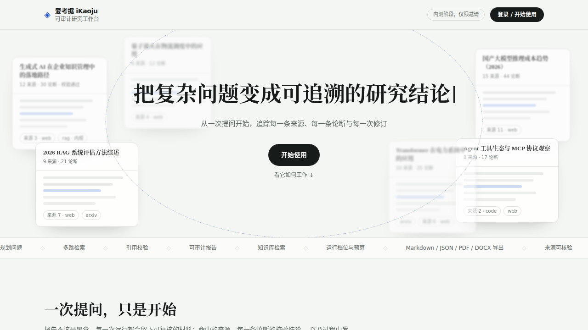
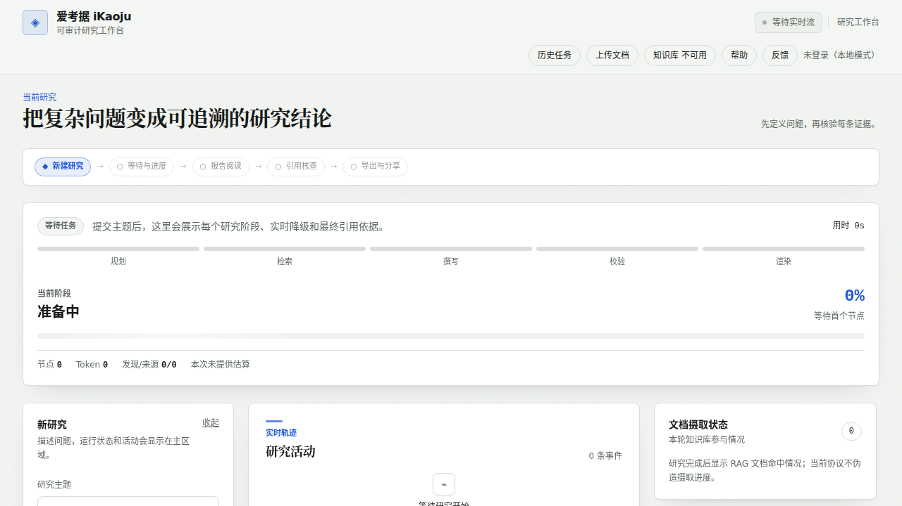
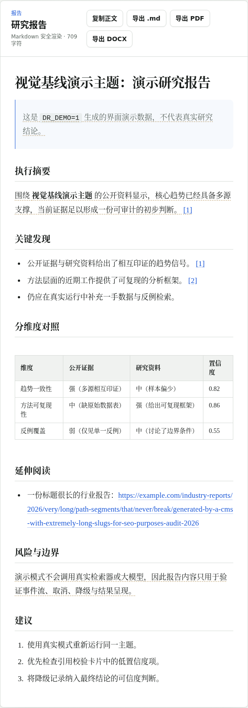
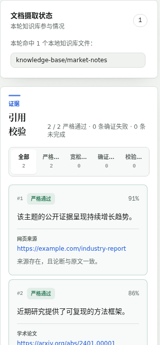

# 爱考据 iKaoju — 可审计的深度研究 Agent

[](https://github.com/TianJinYing2006/ikaoju/actions/workflows/ci.yml)
[](https://opensource.org/licenses/MIT)


> 输入一个研究主题：**规划 → 多跳检索（Web + 私有 RAG + arXiv）→ Critic 裁决 → 带引用报告 → 引用校验与证据链分级**。
> 线上受控内测：<https://ikaoju.cn>（需注册；无 SLA 承诺）。GitHub 为权威源，Gitee 仅镜像。

**当前状态（2026-11-23）**：**v0.3.1 已发布**（「后端按域拆分 + 依赖安全 + 界面演示」批次）；主线稳定，
批次详情见 [`docs/plan/2026-11-execution.md`](docs/plan/2026-11-execution.md)。
本项目是**个人研究与工程实践项目**，不是对外产品：能力声明以「有测试/CI 证据」为限。

---

## 这个项目是什么 / 不是什么

| 是 | 不是 |
| --- | --- |
| 一个把「防幻觉」做成**图结构**而不是提示词的 DeepResearch 引擎 | 一个已经证明「研究结论可信」的产品（见下文评测的诚实口径） |
| 一条**可回溯的证据链**：网页快照 → 逐字引文 → 字符偏移 → 分级处置 | 一个通用搜索/问答 API |
| 一套**可复现**的工程纪律：配置快照、prompt hash、评分器版本、产物白名单 | 一个开箱即用的 SaaS（默认值面向本地与受控内测） |
| 有 1500+ 单测、真 PG/Redis 集成、浏览器 E2E 与备份恢复演练的代码库 | 一个通过安全认证/合规备案可以公开运营的服务 |

---

## 界面与演示

以下截图与视频都是**真实构建产物在 DR_DEMO 假图下的渲染**（不调用 LLM、不产生费用；阶段/事件/报告/证据链与真实链路同一条 SSE 管线），
不是设计稿。截图来自视觉回归基线（Linux CI 渲染，见 `web/frontend/e2e/visual-baseline.spec.ts`），刷新方法同该文件注释。

| 落地页 | 工作台（启动态） |
| --- | --- |
|  |  |

| 报告卡片 | 页边证据栏 |
| --- | --- |
|  |  |

- **90 秒演示**：[`docs/assets/demo-90s.webm`](docs/assets/demo-90s.webm)（约 2.0MB，Chrome/Edge/Safari 可播；录制脚本 [`tools/record_demo.cjs`](tools/record_demo.cjs)）
- 演示覆盖：落地页 → 提交主题 → 阶段进度 → 报告正文 → 引用/证据一览。复现步骤见录制脚本头部注释。

---

## 三个核心设计

### 1. 决策循环在图里，不在 prompt 里

`plan → research ⇄ critic → write → validate →[repair]→ render` 是显式的 LangGraph 状态机
（[`research_engine/graph.py`](research_engine/graph.py)）；critic 先过**确定性硬闸**（depth / token），
未触发才调 LLM 做结构化裁决，路由是纯函数（[`research_engine/critic.py`](research_engine/critic.py)）。
LLM 说"继续"但硬闸说超预算 —— 停。不把安全性押在随机性上。

### 2. 证据链可回溯

网页候选实抓正文按内容寻址落盘为**快照**（robots + 预算三闸 + 熔断降级），引用携带
**逐字引文 + 快照内字符偏移**（L0~L2 定位），交付自检与分级处置区分「致命 / 可修」。
实现见 [`research_engine/evidence.py`](research_engine/evidence.py)、
[`research_engine/quote_locate.py`](research_engine/quote_locate.py)、
[`research_engine/evidence_grading.py`](research_engine/evidence_grading.py)。

### 3. 故障可归因、结果可复现

工具 / provider / RAG / 内部错误都有单一来源的 `failure_reason`；每轮 run 落盘配置快照、
实验开关生效值、`prompt_hash`、`scorer_version` 与 git 修订；失败的 run 不会伪装成成功
（[`research_engine/failure_reasons.py`](research_engine/failure_reasons.py)、
[`research_engine/eval/provenance.py`](research_engine/eval/provenance.py)）。

---

## 快速开始

**依赖**：Python 3.11 ~ 3.13（版本闸在 [`research_engine/__init__.py`](research_engine/__init__.py)）、
Node 22（仅前端）、Qdrant、PostgreSQL / Redis（可选，用于持久化与队列）。

```bash
# 1) 后端依赖（两份 lock 分别固定运行与开发依赖）
python -m pip install -r requirements-lock.txt -r requirements-dev-lock.txt
cp .env.example .env          # 至少填 DASHSCOPE_API_KEY（LLM）与 BOCHA_API_KEY（搜索）

# 2) 知识库（可选）
docker run -p 6333:6333 qdrant/qdrant

# 3) 启动后端（生产模式下直接托管前端构建产物）
uvicorn web.backend.main:app --host 127.0.0.1 --port 8000

# 4) 前端开发（另开终端）
cd web/frontend && npm ci && npm run dev
```

全栈（PostgreSQL + Redis + 迁移 + API + Worker + MinIO）：

```bash
docker compose -f docker-compose.staging.yml up -d --build
curl http://127.0.0.1:8000/api/health/ready
```

完整配置项见 [`.env.example`](.env.example) 与
[`docs/operations/production-readiness.md`](docs/operations/production-readiness.md)；
部署与回滚见 [`docs/operations/release-runbook.md`](docs/operations/release-runbook.md)。

## 测试

```bash
# 零依赖 lane（与 CI 同口径；不需要 PG/Redis/API key）
py -3.13 -m pytest tests/ --tb=no

# 真 PG/Redis 集成 lane（CI infra job 强制跑）
DR_TEST_INTEGRATION=1 py -3.13 -m pytest tests/ -q

# 浏览器 E2E（DR_DEMO=1 假图 + 真实 SSE 管线）
cd web/frontend && npm ci && npm run e2e
```

## 评测：先说"不能说什么"

评测集是 **20 道中文自建题**（AI 草稿 + 人工校准），不是公开 benchmark；结论不外推到其它语言/模型。
**同一指标在不同口径/裁判/断点下不可直接比较**：

- 各口径的数值、采集命令、日期与断点**只登记在** [`docs/figures.md`](docs/figures.md) §4（本 README 不复述数字，避免第二份会漂移的副本）；
- 判定过程见 [`docs/eval-w8-after-baseline.md`](docs/eval-w8-after-baseline.md)、
  [`docs/eval-w9-baseline.md`](docs/eval-w9-baseline.md)、
  [`docs/eval-w7-conclusion.md`](docs/eval-w7-conclusion.md)；
- **四指标配对统计均未达判定门槛 ⇒ 本仓库不宣称任何「质量提升/下降」**；
- 无引用事实句比例、被系统自标「信息不足」的报告小节占比同样在 figures §4 ——
  **研究质量仍是本项目最诚实的短板**，也是后续迭代的主目标。

## 架构与目录

```
research_engine/     # 引擎：graph / agents / critic / evidence / rag / search / llm / eval / runtime
web/backend/         # FastAPI：API、SSE、RunStore、Worker、鉴权、RAG、审核、运维（模块化中）
web/frontend/        # React + TS + Vite + Tailwind；E2E 在 web/frontend/e2e
migrations/          # 31 个前向迁移 + 31 条 schema 结构断言（只前向、字节不可变）
tools/               # CI 守卫、figures 生成、备份/恢复/迁移脚本
docs/                # 需求 45 篇、ADR 20 篇、评测结论、运维 runbook、legal
```

关键设计决策见 [`docs/decisions/README.md`](docs/decisions/README.md)；
工程约束与 PR 纪律见 [`CONTRIBUTING.md`](CONTRIBUTING.md)。

## 质量与 CI

| 指标 | 当前值 | 采集口径 / 日期 |
| --- | --- | --- |
| 单元测试 | **1576 项**（2026-11-22 本机 Python 3.13 + 锁定依赖：1496 通过 / 80 跳过；另有 1 个模块级 collection-skip，pytest 汇总显示 81 skipped） | `pytest --collect-only`；跳过项为真实 PG/Redis 集成用例，由 CI `infra` job 强制执行 |
| 浏览器 E2E | **89 个用例 / 21 个 spec** | `npx playwright test --list`；desktop + mobile 双 project，`DR_DEMO=1` |

- **CI**：ruff + Python 3.11/3.12/3.13 矩阵（3.13 档带 **coverage 门禁 ≥73%**）+
  frontend（tsc / vitest / 生产依赖审计 / build）+ infra（真实 PostgreSQL/Redis、迁移幂等、
  结构断言、**备份→清库→恢复演练**）+ e2e（官方 Chromium）+
  **security-windows**（Windows 专属沙箱安全路径，Linux 上会被 skip）。
- **仓库守卫（6 个）**：评测产物白名单 ≡ git 跟踪、前端不得 import 引擎、公开仓真实 IP 扫描、
  文档/数字一致性（含 ADR 索引与 figures）、Tailwind token、UI 反模式；
  `tools/gen_figures.py --check` 额外机器校验 figures 里的结构事实。
- **迁移不可变**：已应用迁移按 sha256 校验，修改历史迁移会被 CI 守卫拦下。

## 已知边界（不要当成能力）

- **不是生产级服务**：内容审核默认是本地规则词表（`local_rules`，默认空词表），无邮箱验证/CAPTCHA，
  无资质审核服务；开放注册仅限受控内测。见 [`CONTRIBUTING.md`](CONTRIBUTING.md) §2。
- **代码执行沙箱不是恶意代码隔离**：subprocess + AST 白名单 + PEP 578 Audit Hook 三层纵深，
  但无 OS 级/内存隔离；默认不把代码结果当事实证据。见
  [`docs/requirements/8-fault-transparency-and-reproducibility.md`](docs/requirements/8-fault-transparency-and-reproducibility.md)。
- **搜索是单点**（博查；Tavily/arXiv 默认关闭）；子问题之间仍串行。
- **RAG 差异化路径尚未进入正式评测**（评测路径无知识库），其收益没有量化证据。

## 文档地图

| 文档 | 内容 |
| --- | --- |
| [`CONTRIBUTING.md`](CONTRIBUTING.md) | 工程约束、PR 纪律、L3 边界、AI 协作规则 |
| [`docs/figures.md`](docs/figures.md) | 对外数字唯一来源（含采集命令与日期） |
| [`docs/status/current.md`](docs/status/current.md) | 当前状态单页（能做什么 / 进行中 / 不宣称什么） |
| [`docs/plan/2026-11-execution.md`](docs/plan/2026-11-execution.md) | 2026-11 重构批次：已完成 / 未完成 / 原因 |
| [`docs/decisions/`](docs/decisions/) | ADR（决策背景、取舍、影响） |
| [`docs/requirements/`](docs/requirements/) | 需求与验收记录（按批次） |
| [`docs/eval-w8-after-baseline.md`](docs/eval-w8-after-baseline.md) | 评测基线与统计判定过程 |
| [`docs/operations/release-runbook.md`](docs/operations/release-runbook.md) | 发布、回滚、备份恢复 runbook |

## 许可

MIT，见 [LICENSE](LICENSE)。第三方审计 skills 等仅本机使用的资产不随仓库分发（见 `.gitignore` 注释）。
